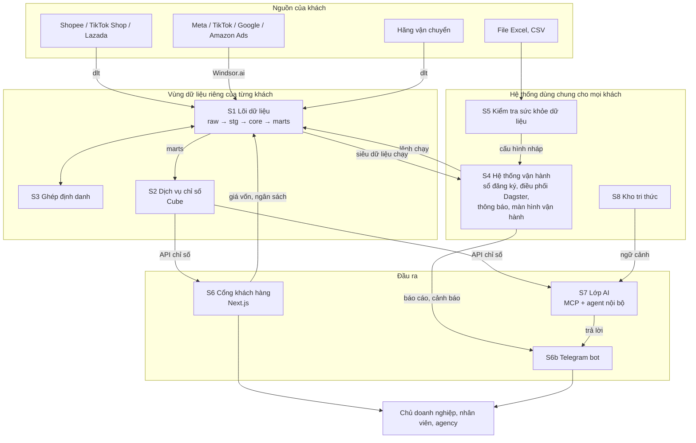
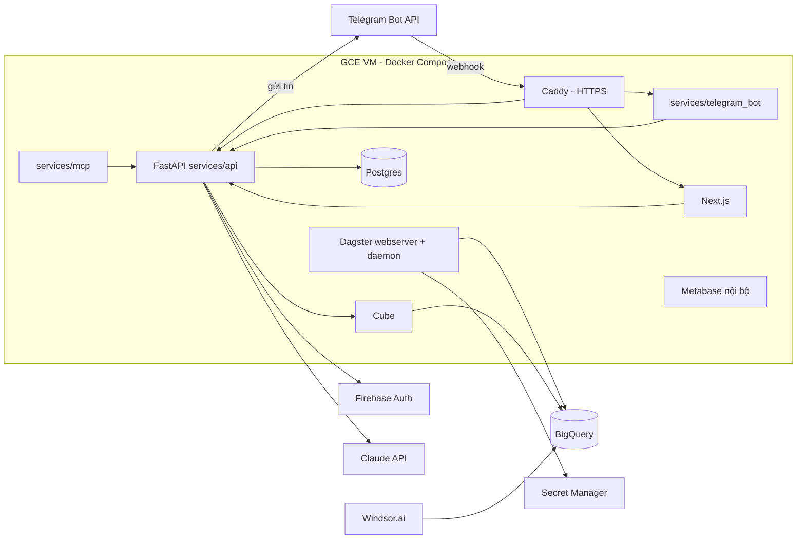
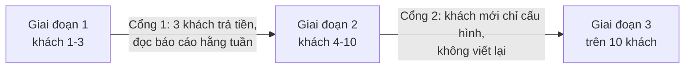

# DataxLand – Tài liệu kiến trúc

| | |
|---|---|
| Phiên bản | 0.3 |
| Ngày | 16/10/2026 |
| Chủ sở hữu | Trịnh Công Tân |
| Trạng thái | Đã duyệt, làm đầu vào cho PRD và specs |
| Tài liệu liên quan | `docs/prd.md`, `docs/specs/*`, `docs/adr/*` |

---

## 1. Tóm tắt

DataxLand là nền tảng giúp một trưởng nhóm data, cùng AI, triển khai và vận hành dữ liệu cho nhiều SME cùng ngách. Mục tiêu là không phải làm lại từ đầu cho mỗi khách. Khách nhận được số liệu đúng, báo cáo hằng tuần và AI hỏi đáp trên chính dữ liệu của họ, ngay trong Telegram hoặc trên cổng web.

Nền tảng gồm **8 hệ thống nhỏ**. Chúng chỉ nối với nhau qua **5 giao diện chung**: sổ đăng ký khách, siêu dữ liệu chạy, API chỉ số, bảng dùng chung và sự kiện.

Giai đoạn 1 phục vụ **2 gói ngách**:

- **Gói Seller đa sàn:** Shopee, TikTok Shop, Lazada, cộng với quảng cáo và vận chuyển.
- **Gói Agency quảng cáo:** Meta Ads, TikTok Ads, Google Ads, Amazon Ads, cộng với dữ liệu bán hàng trên sàn.

### 1.1 Các quyết định đã chốt

| # | Chủ đề | Quyết định | Ghi chú |
|---|---|---|---|
| D1 | Hạ tầng và nơi đặt dữ liệu | GCP trước (BigQuery), thiết kế để chuyển được sang cloud trong nước | Mục 10 mô tả đường chuyển |
| D2 | Ngách đầu tiên | 2 gói: Seller đa sàn và Agency quảng cáo (có Amazon Ads) | Mục 6 |
| D3 | Lớp ngữ nghĩa | Cube | Chạy tự quản (self-hosted) |
| D4 | Ngôn ngữ cho phần tự xây | Python (FastAPI) cho backend và pipeline, Next.js cho giao diện | |
| D5 | Kéo dữ liệu | Windsor.ai cho quảng cáo và Amazon; connector tự viết bằng dlt cho Shopee, TikTok Shop, Lazada, vận chuyển | Giữ đường lui sang Airbyte tự vận hành nếu cần tối ưu chi phí Windsor (mục 5.1) |
| D6 | Triển khai | Giai đoạn 1: một VM chạy Docker Compose. Từ giai đoạn 2 (trên 3 khách): Cloud Run và Cloud SQL | Mục 10 |
| D7 | Dashboard cho khách | Biểu đồ tự vẽ trong Next.js, lấy số từ API của Cube. Metabase chỉ dùng nội bộ để team khám phá dữ liệu | |
| D8 | Đăng nhập | Firebase Auth, phân quyền bằng custom claims | Mục 9 |
| D9 | Điều phối | Dagster | |
| D10 | Mô hình AI | Claude qua API, đặt sau một lớp trừu tượng để đổi nhà cung cấp được | |
| D11 | Kênh liên lạc với khách | Telegram bot và email. Bot nhận báo cáo, cảnh báo, lệnh nhanh và hỏi AI. Lớp thông báo độc lập với kênh để thêm Zalo nếu cần | Mục 8.3, 9.4; rủi ro ở mục 16 |

---

## 2. Bối cảnh, mục tiêu và phạm vi

### 2.1 Vấn đề

SME bán đa kênh có dữ liệu nằm rải rác qua nhiều nền tảng. Họ không có ai đủ năm năng lực sau:

1. Mô hình hóa nghiệp vụ.
2. Định nghĩa bộ chỉ số chuẩn.
3. Giữ kỷ luật ghi dữ liệu tại nguồn.
4. Vận hành dữ liệu tin cậy.
5. Gắn dữ liệu với quyết định và đo lại kết quả.

Phần kỹ thuật như kéo dữ liệu, kho dữ liệu và BI đã thành hàng phổ thông. Thứ còn khan hiếm là phần định nghĩa và phần trách nhiệm.

### 2.2 Mục tiêu kiến trúc

| Mục tiêu | Thước đo |
|---|---|
| Khách mới chủ yếu là cấu hình, không viết code mới | Số dòng code mới cho mỗi khách mới, số ngày thiết lập |
| Mọi đầu ra dùng chung một định nghĩa chỉ số | 0 chỉ số được tính bằng SQL riêng ở tầng đầu ra |
| Một người vận hành được nhiều khách | Số giờ người mỗi khách mỗi tháng |
| Dữ liệu các khách tách biệt | 0 truy vấn đọc chéo giữa hai khách |
| Đổi được từng hệ thống mà không phá hệ khác | Hợp đồng giao diện có phiên bản |

### 2.3 Ngoài phạm vi

- Thay phần mềm vận hành của khách như POS, kế toán, CRM.
- Ghi ngược dữ liệu vào hệ thống của khách (reverse ETL) ở giai đoạn 1 và 2.
- Dữ liệu thời gian thực. Chu kỳ nhỏ nhất là 1 giờ.
- Doanh nghiệp lớn đã có đội data riêng.

---

## 3. Nguyên tắc thiết kế

1. **Hệ thống nhỏ, nối bằng giao diện rõ ràng.** Không hệ thống nào đọc thẳng vào database nội bộ của hệ khác.
2. **Cấu hình dưới dạng code.** Mỗi khách là một file YAML có phiên bản trong git. Giao diện quản trị chỉ sinh ra hoặc đề xuất sửa file đó.
3. **Một định nghĩa cho mỗi chỉ số.** Báo cáo, dashboard, cảnh báo và AI đều đọc qua Cube.
4. **Dữ liệu khách tách biệt mặc định.** Chỉ số liệu đã tổng hợp, ẩn danh và có đồng ý mới được gom chung.
5. **AI đề xuất, người duyệt.** Mọi thứ AI tạo ra (ghép định danh, nhận định trong báo cáo, thay đổi code) đều qua bước duyệt.
6. **Xây khi đã lặp lại.** Một thành phần chỉ được tổng quát hóa khi đã dùng thật cho ít nhất 2 khách.
7. **Không khóa vào nhà cung cấp ở tầng lõi.** SQL lõi dùng macro đa nền tảng của dbt; mọi dịch vụ chạy trong container.

---

## 4. Bản đồ hệ thống

### 4.1 Sơ đồ tổng thể



### 4.2 Danh sách hệ thống

| Mã | Hệ thống | Nhóm công cụ | Việc chính | Thành phần mua ngoài hoặc mã nguồn mở | Tự xây |
|---|---|---|---|---|---|
| S1 | Lõi dữ liệu | Tài sản dữ liệu | Kéo, chuẩn hóa, mô hình chung, kiểm tra chất lượng | Windsor.ai, dlt, BigQuery, dbt Core, Elementary | Connector dlt, adapter, mô hình chung, test đối soát |
| S2 | Dịch vụ chỉ số | Tài sản dữ liệu | Thư viện chỉ số, API truy vấn, phát hiện bất thường | Cube | Định nghĩa chỉ số, gói ngách, bộ phát hiện bất thường |
| S3 | Ghép định danh | Tài sản dữ liệu | Ghép sản phẩm và khách hàng xuyên kênh | Claude API | Engine ghép, hàng chờ duyệt |
| S4 | Hệ thống vận hành | Công cụ vận hành | Sổ đăng ký, điều phối, thông báo, màn hình vận hành, thiết lập khách mới | Dagster, Postgres, dịch vụ email | API vận hành, màn hình, quy trình thiết lập, lớp thông báo |
| S5 | Kiểm tra sức khỏe dữ liệu | Công cụ vận hành | Phân tích file khách xuất, chỉ ra chỗ mất tiền | Dùng lại S1 | Luồng tải file, báo cáo |
| S6 | Cổng khách hàng | Đầu ra cho khách | Báo cáo tuần, dashboard, sổ tay chỉ số, nhật ký quyết định, nhập giá vốn và ngân sách | Next.js, Firebase Auth | Toàn bộ |
| S6b | Telegram bot | Đầu ra cho khách | Nhận báo cáo và cảnh báo, lệnh nhanh, hỏi AI không cần vào app (mục 9.4) | Telegram Bot API | Bot gateway, liên kết tài khoản |
| S7 | Lớp AI | Đầu ra; tri thức | AI hỏi đáp cho khách (qua cổng và Telegram), agent nội bộ cho team | Claude API | MCP server, skill cho agent |
| S8 | Kho tri thức | Tri thức và quy trình | Playbook, từ điển thuật ngữ, so sánh ngành, mẫu pháp lý | Git, Markdown | Nội dung, bộ tổng hợp so sánh ngành |

---

## 5. Hệ thống lõi dữ liệu (S1)

### 5.1 Kéo dữ liệu

| Nhóm nguồn | Công cụ | Lý do |
|---|---|---|
| Meta Ads, TikTok Ads, Google Ads, Amazon Ads | Windsor.ai, đổ thẳng vào BigQuery | Connector có sẵn, ổn định, đỡ công bảo trì API quảng cáo |
| Amazon Seller Central (SP-API) | Windsor.ai | Cần cho TACOS ở gói Agency |
| Shopee, TikTok Shop, Lazada | Connector tự viết bằng dlt, chạy trong Dagster | Kiểm soát độ sâu dữ liệu: phí, quyết toán, hoàn hàng |
| Hãng vận chuyển (GHN, GHTK, J&T…) | Connector tự viết bằng dlt | Windsor chưa có |
| File Excel và CSV | dlt (nguồn filesystem) | Dùng cho S5 và nguồn chưa có API |
| Dữ liệu khách nhập trên cổng (giá vốn theo SKU, ngân sách quảng cáo) | dlt đọc từ Postgres của S6 | Nạp vào `raw` như một nguồn tên `portal`, để mọi dữ liệu đi qua cùng một luồng |
| Tỷ giá (Vietcombank, hằng ngày) | dlt, nguồn `fx_vcb` | Ghi vào dataset dùng chung `dx_ref`, dùng để quy đổi tiền về VND theo ngày giao dịch |

**Hợp đồng nạp dữ liệu.** Mọi công cụ kéo dữ liệu, dù là Windsor, dlt hay Airbyte sau này, đều phải ghi vào cùng một chuẩn:

- Dataset: `t_<tenant_id>_raw`
- Bảng: `<source>__<object>`, ví dụ `shopee__orders`, `meta_ads__ad_insights_daily`
- Cột bắt buộc: `_dx_loaded_at` (thời điểm nạp), `_dx_source_account` (mã tài khoản nguồn)

Nhờ hợp đồng này, đổi công cụ kéo chỉ cần viết lại adapter `stg` cho nguồn đó. Các lớp phía trên không đổi.

**Đường lui khỏi Windsor.** Nếu chi phí Windsor cần tối ưu, chuyển từng nguồn sang Airbyte tự vận hành hoặc dlt mà vẫn giữ hợp đồng nạp. Windsor.ai cũng liệt kê connector cho Shopee, Lazada và TikTok Shop. Có thể dùng tạm cho giai đoạn 1 trong lúc connector dlt chưa xong, nhưng cần kiểm tra trước xem dữ liệu phí và quyết toán của Windsor có đủ sâu không.

**Rủi ro API sàn.** Shopee, TikTok Shop và Lazada yêu cầu đăng ký ứng dụng đối tác và được duyệt quyền. Việc này cần làm sớm vì có thể mất nhiều tuần. Đây là việc phải bắt đầu ngay ở giai đoạn 1.

### 5.2 Các lớp biến đổi (dbt)

| Lớp | Dataset | Quy ước tên model | Việc |
|---|---|---|---|
| Thô | `t_<id>_raw` | (do công cụ nạp đặt tên) | Giữ nguyên, không sửa |
| Chuẩn hóa nguồn | `t_<id>_stg` | `stg_<source>__<object>` | Đổi tên, ép kiểu, đổi múi giờ về `Asia/Ho_Chi_Minh`, quy đổi tiền tệ, map trạng thái về bộ chuẩn |
| Mô hình chung | `t_<id>_core` | `dim_<entity>`, `fct_<entity>` | Ghép nhiều nguồn về các thực thể chung (mục 5.3) |
| Định danh | `t_<id>_core` | `int_identity__<entity>` | Áp bảng ghép đã duyệt từ S3 |
| Phục vụ | `t_<id>_marts` | `mrt_<pack>__<topic>` | Bảng đã gộp sẵn cho Cube đọc |

**Một dự án dbt, chạy riêng cho từng khách.** Dagster gọi `dbt build --vars '{tenant_id: ..., sources: [...], pack: ...}'` với target trỏ vào dataset của khách đó. Adapter của nguồn mà khách không dùng sẽ tự tắt qua biến `enabled`.

**Ánh xạ nằm trong seed và YAML, không nằm trong SQL.** Ví dụ, ánh xạ trạng thái đơn của từng sàn nằm trong `transform/seeds/status_map__<source>.csv`. Khách có trạng thái riêng thì ghi đè trong file cấu hình của khách.

### 5.3 Mô hình dữ liệu chung

Mọi bảng đều có `tenant_id`, `source`, `source_id` (mã gốc ở nguồn) và `_dx_updated_at`.

| Thực thể | Model | Một dòng là | Khóa | Trường chính |
|---|---|---|---|---|
| Kênh | `dim_channel` | Một gian hàng hoặc một tài khoản quảng cáo | `channel_id` | `channel_type` (marketplace, ads, website, pos), `platform`, `name`, `currency` |
| Khách mua | `dim_customer` | Một người mua sau khi ghép | `customer_id` | `phone_hash`, `email_hash`, `first_order_at`, `first_channel_id` |
| Sản phẩm | `dim_product` | Một SKU sau khi ghép xuyên kênh | `product_id` | `canonical_name`, `category`, `barcode` |
| Giá vốn | `dim_product_cost` | Giá vốn của một sản phẩm trong một khoảng thời gian; nguồn là bảng khách nhập trên cổng | `product_id`, `valid_from` | `unit_cost`, `valid_to` |
| Ngân sách quảng cáo | `dim_ad_budget` | Ngân sách một nền tảng trong một tháng; nguồn là bảng khách nhập trên cổng | `channel_id`, `month` | `budget_amount` |
| Đơn hàng | `fct_order` | Một đơn trên một kênh | `order_id` | `channel_id`, `customer_id`, `ordered_at`, `status` (chuẩn), `gross_amount`, `discount_amount`, `net_amount` |
| Dòng đơn | `fct_order_line` | Một sản phẩm trong một đơn | `order_line_id` | `order_id`, `product_id`, `quantity`, `unit_price`, `allocated_discount` |
| Chi phí | `fct_cost` | Một khoản chi gắn với đơn, kênh hoặc ngày | `cost_id` | `cost_type` (platform_fee, payment_fee, shipping, ad_spend, other), `amount`, `order_id?`, `channel_id?`, `cost_date` |
| Hoàn hàng | `fct_return` | Một lần trả hoặc hủy một dòng đơn | `return_id` | `order_line_id`, `reason` (chuẩn), `refund_amount`, `return_fee` |
| Hiệu quả quảng cáo | `fct_ad_performance_daily` | Một nhóm quảng cáo trong một ngày | `channel_id`, `campaign_id`, `adgroup_id`, `date` | `spend`, `impressions`, `clicks`, `conversions`, `conversion_value` (do nền tảng báo) |

**Bộ trạng thái đơn chuẩn:** `pending`, `confirmed`, `shipping`, `delivered`, `completed`, `cancelled`, `returned`, `failed_delivery`.

**Quy tắc chi phí:**

- Chi phí quảng cáo trong `fct_cost` được sinh từ `fct_ad_performance_daily`, gắn theo `channel_id` và ngày.
- Khoản không gắn được vào đơn thì phân bổ theo quy tắc trong cấu hình khách: theo doanh thu, theo số đơn, hoặc không phân bổ.

**Lưu ý về khách mua trên sàn.** Shopee, TikTok Shop và Lazada thường che thông tin người mua. Vì vậy chỉ số về khách quay lại ở gói Seller chỉ dùng được khi có định danh. Định danh này có thể đến từ mã người mua mà sàn cung cấp, hoặc từ kênh riêng của khách như website và Zalo.

### 5.4 Kiểm tra chất lượng

Kiểm tra được viết bằng dbt test cộng gói Elementary. Kết quả được ghi vào siêu dữ liệu chạy.

| Loại | Cài đặt | Mức độ |
|---|---|---|
| Độ tươi | `freshness` trên nguồn, ngưỡng lấy từ cấu hình khách | Chặn |
| Khóa và trùng | `unique`, `not_null`, `relationships` trên mọi khóa | Chặn |
| Đối soát với nguồn | Test tự viết: so số đơn và doanh thu theo ngày với báo cáo tổng của nền tảng, lệch quá ngưỡng thì lỗi | Chặn |
| Bất thường | Elementary anomaly trên khối lượng và trên các chỉ số chính | Cảnh báo |

**Quy tắc chặn.** Khi có test mức "chặn" bị lỗi, Dagster dừng các bước sau cho khách đó: không làm mới cache Cube và không dựng báo cáo tuần. Hệ thống phát sự kiện `test.failed`.

---

## 6. Dịch vụ chỉ số (S2) và hai gói ngách

### 6.1 Cube

- **Một Cube deployment cho mọi khách**, đa khách qua `securityContext.tenant_id`.
- `repositoryFactory` hoặc `COMPILE_CONTEXT` trỏ mỗi khách vào dataset `t_<id>_marts` của khách đó.
- Model của Cube được sinh ra từ thư viện chỉ số (mục 6.2), không viết tay trong Cube. Lý do là để giữ một nguồn định nghĩa duy nhất, kèm mô tả tiếng Việt và ngưỡng bất thường.
- Cube cung cấp REST API và SQL API. Chỉ `services/api` gọi REST API; cổng khách, Telegram bot và MCP server đều đi qua `services/api`. Metabase nội bộ dùng SQL API.
- Pre-aggregation của Cube được làm mới khi nhận sự kiện `transform.finished`.

### 6.2 Định nghĩa chỉ số

Thư mục `semantic/metrics/` chứa mỗi chỉ số một file YAML. Script `semantic/build.py` sinh ra model Cube, sổ tay chỉ số và ngữ cảnh cho AI từ các file này.

```yaml
metric: net_profit_after_fees
name_vi: Lãi sau phí sàn và quảng cáo
version: 1.0.0
description_vi: Doanh thu thực nhận trừ giá vốn, phí sàn, phí thanh toán, quảng cáo, vận chuyển và hoàn hàng.
type: derived
formula: net_revenue - cogs - platform_fees - payment_fees - ad_spend - shipping_cost - return_cost
dimensions: [channel, platform, product, category, date]
time_grains: [day, week, month]
unit: VND
good_direction: up
anomaly:
  compare: trailing_4_weeks
  threshold_pct: 30
synonyms_vi: [lãi, lời, lợi nhuận, lãi ròng]
packs: [seller, agency]
owner: data-lead
```

**Phiên bản.** Đổi công thức thì tăng `version`. Mỗi kết quả trả về từ API và mỗi báo cáo đều ghi phiên bản chỉ số đã dùng.

### 6.3 Gói Seller đa sàn (`pack: seller`)

| Chỉ số | Mô tả |
|---|---|
| `gmv` | Tổng giá trị đơn trước giảm giá |
| `net_revenue` | Doanh thu thực nhận sau giảm giá và hoàn |
| `order_count`, `aov` | Số đơn, giá trị đơn trung bình |
| `cancel_rate`, `return_rate` | Tỷ lệ hủy, tỷ lệ hoàn |
| `platform_fees`, `payment_fees`, `shipping_cost` | Các nhóm phí |
| `ad_spend`, `roas_blended` | Chi phí quảng cáo; doanh thu thực nhận chia chi phí quảng cáo |
| `cogs` | Giá vốn hàng đã bán |
| `contribution_margin` | Biên đóng góp sau giá vốn và phí biến đổi |
| `net_profit_after_fees` | Lãi sau mọi phí |
| `sku_profit` | Lãi theo SKU, để tìm sản phẩm đang lỗ |
| `repeat_customer_rate` | Chỉ bật khi có định danh khách mua |

### 6.4 Gói Agency quảng cáo (`pack: agency`)

| Chỉ số | Mô tả |
|---|---|
| `ad_spend` theo nền tảng | Meta, TikTok, Google, Amazon |
| `impressions`, `clicks`, `ctr`, `cpc`, `cpm` | Chỉ số phân phối |
| `conversions`, `cpa` | Chuyển đổi và chi phí mỗi chuyển đổi, theo nền tảng báo |
| `roas_platform` | ROAS do nền tảng báo |
| `roas_blended`, `mer` | Doanh thu bán thực tế chia tổng chi quảng cáo; đối chiếu với số nền tảng báo |
| `acos`, `tacos` | Amazon: chi quảng cáo chia doanh thu quảng cáo; chi quảng cáo chia tổng doanh thu |
| `budget_pacing` | Đã chi so với ngân sách tháng theo nền tảng (`dim_ad_budget`) |
| `platform_vs_actual_gap` | Chênh lệch giữa doanh thu nền tảng quảng cáo báo và doanh thu thật trên sàn |

**Đối tác agency.** Một agency có quyền xem nhiều khách, mỗi khách phải đồng ý. Gói Agency có thêm một trang tổng hợp nhiều khách cho agency (mục 9.1, 9.2).

---

## 7. Ghép định danh (S3)

Ghép định danh là một worker Python cộng với các API trong `services/api`. Mỗi lần chạy theo khách đi qua 5 bước:

1. **Lấy ứng viên:** sản phẩm và khách mua chưa ghép, từ `t_<id>_stg`.
2. **Ghép theo quy tắc:** các trường hợp chắc chắn như mã vạch trùng, SKU trùng, số điện thoại hoặc email đã chuẩn hóa trùng. Các cặp này được duyệt tự động.
3. **Ghép gợi ý:** so độ giống của tên và thuộc tính, sau đó Claude so từng cặp và trả về điểm tin cậy kèm lý do.
4. **Hàng chờ duyệt:** cặp gợi ý có điểm từ ngưỡng gợi ý trở lên phát sự kiện `match.proposed` và chờ người duyệt trên màn hình vận hành; gợi ý không bao giờ được duyệt tự động. Cặp dưới ngưỡng bị bỏ qua. Người mua chỉ được ghép theo quy tắc, không qua AI.
5. **Ghi kết quả:** cặp đã duyệt ghi vào bảng `t_<id>_core.identity_map(entity, source, source_id, canonical_id, method, approved_by, approved_at)`. Mọi quyết định duyệt và từ chối được lưu lại để chỉnh ngưỡng.

**Bảo vệ dữ liệu cá nhân.** Số điện thoại và email chỉ ở dạng gốc trong `raw` và `stg`. Từ `core` trở lên chỉ lưu dạng băm có muối riêng theo khách (`phone_hash`, `email_hash`).

---

## 8. Hệ thống vận hành (S4) và kiểm tra sức khỏe (S5)

### 8.1 Sổ đăng ký khách

Thư mục `tenants/` chứa mỗi khách một file YAML. File này là nguồn sự thật. API vận hành đồng bộ nó vào Postgres để các hệ thống khác đọc nhanh.

```yaml
tenant_id: acme01
name: Cửa hàng ACME
status: active            # trial | active | paused | offboarding
pack: seller              # seller | agency
warehouse:
  provider: bigquery
  project: dataxland-prod
  location: asia-southeast1
sources:
  - type: shopee
    connector: dlt
    shop_id: "123456"
    secret_ref: projects/dataxland-prod/secrets/acme01-shopee
  - type: meta_ads
    connector: windsor
    account_id: "act_987"
schedule:
  sync: "0 */3 * * *"
  weekly_report: "MON 07:00"
quality:
  freshness_hours: 6
  reconcile_tolerance_pct: 1.0
cost_allocation: by_revenue
overrides:
  status_map: tenants/overrides/acme01_status_map.csv
notify:
  channels: [telegram, email]   # kênh bật cho khách này
  email: [owner@acme.vn]
benchmark_opt_in: false
partners: []              # agency_id được xem dữ liệu khách này
```

Khóa API và token của nguồn không bao giờ nằm trong file này. File chỉ lưu `secret_ref` trỏ sang Secret Manager. Liên kết Telegram (chat nào thuộc người dùng nào) không nằm trong file này mà trong Postgres, vì nó do người dùng tự tạo lúc chạy (mục 9.4).

### 8.2 Bộ điều phối (Dagster)

- Mỗi khách là một partition. Dagster đọc sổ đăng ký để biết danh sách khách.
- Pipeline chuẩn cho một khách gồm các bước:
  1. Kéo dữ liệu qua dlt.
  2. Kiểm tra Windsor đã nạp xong chưa.
  3. `dbt build`.
  4. Chạy kiểm tra chất lượng.
  5. Làm mới Cube.
  6. Chạy phát hiện bất thường.
  7. Dựng báo cáo nếu đến lịch.
- Bước nào lỗi thì các bước sau không chạy, và hệ thống phát sự kiện tương ứng.
- Dagster sensor lắng nghe bảng sự kiện (mục 11.2) để chạy các việc kích hoạt bởi sự kiện.

### 8.3 Trung tâm thông báo

- Một module trong `services/api` nhận sự kiện, tra sổ đăng ký và bảng liên kết Telegram để biết người nhận, rồi gửi qua các kênh đã bật.
- Lớp thông báo độc lập với kênh: mỗi kênh là một adapter (`telegram`, `email`) có cùng giao diện `send(recipient, message)`. Thêm Zalo sau này là thêm một adapter.
- Team nhận mọi lỗi kỹ thuật qua một nhóm Telegram nội bộ và email.
- Khách chỉ nhận hai loại: `report.ready` và `metric.anomaly`. Nhắc hạn đo lại trong nhật ký quyết định gửi cho team.
- Khách không bao giờ nhận số liệu của một lần chạy đang bị chặn bởi test.
- Không kênh nào được gửi thông tin cá nhân của người mua.
- Mẫu tin nhắn có phiên bản, nằm trong `services/api/notify/templates/`, mỗi mẫu có bản cho Telegram và bản cho email.

### 8.4 Màn hình vận hành

Màn hình vận hành là các trang `/ops/*` trong ứng dụng Next.js, chỉ vai trò nội bộ mới vào được. Mỗi khách hiện thành một dòng:

| Cột | Nguồn |
|---|---|
| Lần đồng bộ gần nhất của từng nguồn, trạng thái | Siêu dữ liệu chạy (Dagster, Windsor) |
| Test đang lỗi theo mức | Kết quả dbt và Elementary |
| Báo cáo tuần: đã dựng, đã duyệt, đã gửi, khách đã mở | API vận hành |
| Cặp ghép đang chờ duyệt (giai đoạn 2) | S3 |
| Chi phí tháng này: BigQuery, Windsor, Claude (giai đoạn 2) | Billing export của GCP và hóa đơn nhà cung cấp, chia theo nhãn khách |
| Giờ người tháng này (giai đoạn 2) | Nhập tay |

Mọi tài nguyên GCP đều gắn nhãn `tenant_id` để chia được chi phí theo khách.

### 8.5 Thiết lập khách mới

Giai đoạn 1, trưởng nhóm data viết tay `tenants/<id>.yml` và mở pull request. Từ giai đoạn 2, bước 1 và 2 được thay bằng biểu mẫu:

1. Biểu mẫu nghiệp vụ trong `/ops/onboarding`: kênh bán, nguồn dữ liệu, cách tính giá vốn, trạng thái riêng, người nhận báo cáo.
2. API sinh bản nháp `tenants/<id>.yml`. Bản nháp được mở thành một pull request để trưởng nhóm data duyệt.
3. Khi PR được merge, script `ops/bootstrap_tenant.py` tạo dataset, tài khoản dịch vụ, phân quyền, khai báo secret và đăng ký partition trong Dagster. Sau đó phát `tenant.created`.
4. Lần chạy đầu tiên nạp dữ liệu lịch sử, chạy toàn bộ test và đối soát.
5. Buổi bàn giao: đi qua sổ tay chỉ số và báo cáo đầu tiên cùng khách.

### 8.6 Kiểm tra sức khỏe dữ liệu (S5)

- **Đầu vào:** khách tải lên file xuất từ sàn, quảng cáo và vận chuyển trên trang `/health-check`. Trang này không cần đăng nhập đầy đủ, chỉ cần email.
- **Xử lý:** mỗi lượt kiểm tra là một khách tạm với `tenant_id = hc_<check_id>`. dlt nạp file vào `hc_<check_id>_raw`, bỏ thông tin cá nhân người mua ngay khi đọc. Sau đó chạy cùng dự án dbt, cùng Cube và cùng các chỉ số của gói Seller như khách thật.
- **Đầu ra:** một báo cáo trên web nêu bằng tiền:
  - phí sàn và phí thanh toán đã ăn vào lãi bao nhiêu;
  - các SKU đang lỗ sau phí;
  - hoàn hàng bất thường;
  - số không khớp giữa các nguồn.
- **Lưu giữ:** dataset tạm tự xóa sau 14 ngày, trừ khi khách chuyển sang thiết lập chính thức. Thời hạn này phải ghi rõ cho khách khi tải file.
- **Chuyển sang thiết lập:** phát `healthcheck.completed`. Ánh xạ đã làm được chép thành bản nháp file cấu hình khách.

---

## 9. Cổng khách hàng (S6) và lớp AI (S7)

### 9.1 Cổng khách hàng

Ứng dụng Next.js (App Router), đăng nhập bằng Firebase Auth. Mọi số liệu lấy qua `services/api`, và API này gọi Cube với `tenant_id` lấy từ token. Không lấy `tenant_id` từ tham số người dùng gửi lên.

| Khu vực | Đường dẫn | Nội dung |
|---|---|---|
| Báo cáo tuần | `/app/reports` | Báo cáo một trang: số chính, thay đổi so với tuần trước, nhận định đã duyệt, việc cần làm |
| Dashboard | `/app/dashboards/<pack>` | Biểu đồ vẽ trong Next.js (Recharts hoặc ECharts) từ API chỉ số |
| Sổ tay chỉ số | `/app/metrics` | Sinh từ `semantic/metrics`: tên tiếng Việt, công thức diễn giải, nguồn, phiên bản, lịch sử thay đổi |
| Nhập liệu | `/app/inputs` | Giá vốn theo SKU có ngày hiệu lực (nhập tay hoặc tải Excel); ngân sách quảng cáo theo tháng và nền tảng |
| Nhật ký quyết định | `/app/decisions` | Quyết định, chỉ số đo, giá trị trước, mục tiêu, ngày đo lại, kết quả |
| Hỏi AI | `/app/ask` | Giao diện chat với AI hỏi đáp (giai đoạn 2) |
| Liên kết Telegram | `/app/settings/telegram` | Tạo mã liên kết, xem và gỡ các chat đã liên kết |
| Agency | `/partner` | Tổng hợp nhiều khách cho đối tác agency được cấp quyền |

**Báo cáo tuần** được tạo như sau:

1. Dagster dựng số liệu.
2. Trưởng nhóm data viết nhận định trên `/ops/reports`. Từ giai đoạn 2, agent soạn bản nháp để trưởng nhóm sửa.
3. Trưởng nhóm data duyệt.
4. Hệ thống phát `report.ready`. Trung tâm thông báo gửi tin có ba số chính và link qua Telegram và email, rồi ghi nhận khi khách mở.

**Nhật ký quyết định** được lưu trong Postgres. Khi đến ngày đo lại, một job lấy giá trị chỉ số qua Cube, ghi vào nhật ký và nhắc team kết luận. Cuối kỳ hợp đồng, nhật ký được tổng hợp thành báo cáo giá trị.

### 9.2 Phân quyền trong cổng

Firebase custom claims có dạng `{ role, tenant_ids[], partner_id? }`.

| Vai trò | Quyền |
|---|---|
| `owner` | Mọi thứ của khách mình; quản lý người dùng; bật tắt chia sẻ cho so sánh ngành và cho agency |
| `member` | Chỉ số và báo cáo được owner cấp; mặc định ẩn thông tin cá nhân người mua |
| `partner` | Xem các khách đã đồng ý cấp quyền cho agency đó |
| `data_lead` | Toàn bộ `/ops`; duyệt cấu hình, báo cáo, cặp ghép |
| `engineer` | `/ops` chỉ đọc; thay đổi code qua PR |

### 9.3 AI hỏi đáp

AI hỏi đáp là một dịch vụ dùng chung cho hai giao diện: trang `/app/ask` và Telegram bot (mục 9.4). Cả hai gọi cùng một hàm `ask(user, tenant, question)` trong `services/api`, nên câu trả lời giống nhau dù hỏi ở đâu.

- **MCP server:** `services/mcp`, viết bằng Python. Nó chỉ mở 3 công cụ:
  - `list_metrics()`: danh sách chỉ số khách được xem.
  - `describe_metric(name)`: định nghĩa, công thức, phiên bản.
  - `query_metric(name, dimensions, filters, time_range, grain)`: gọi Cube REST.
- **Không có công cụ chạy SQL hay đọc bảng.** Khách và quyền không do model truyền vào mà nằm trong token phiên do API ký.
- **Ngữ cảnh** gồm từ điển `synonyms_vi` lấy từ thư viện chỉ số, playbook của gói ngách, và hồ sơ khách (kênh, ngân sách, mục tiêu).
- **Mỗi câu trả lời** phải nêu tên chỉ số, phiên bản, khoảng thời gian và thời điểm dữ liệu cập nhật.
- **Câu hỏi ngoài thư viện:** AI trả lời là chưa có chỉ số đó, và ghi câu hỏi vào `metric_requests` để team xem xét.
- **Đánh giá:** mỗi gói có bộ câu hỏi mẫu kèm đáp án trong `ai/evals/<pack>.yaml`. Bộ này chạy lại trong CI mỗi khi đổi model AI, prompt hoặc chỉ số.

### 9.4 Telegram bot

Bot là giao diện để khách dùng DataxLand mà không cần mở cổng web. Nó nhận báo cáo và cảnh báo (giai đoạn 1), và trả lời câu hỏi bằng AI (giai đoạn 2).

**Dịch vụ:** `services/telegram_bot`, Python, nhận cập nhật từ Telegram qua webhook. Bot không có logic nghiệp vụ riêng: mọi việc đều gọi `services/api` với danh tính của người dùng đã liên kết.

**Liên kết tài khoản:**

1. Người dùng đã đăng nhập cổng vào `/app/settings/telegram` và bấm tạo mã. Mã dùng một lần, hết hạn sau 10 phút.
2. Người dùng gửi `/start <mã>` cho bot. Bot gọi API đổi mã lấy liên kết `(chat_id, user_id, tenant_id, scope)` và lưu vào bảng `telegram_links` trong Postgres.
3. Chat chưa liên kết chỉ nhận hướng dẫn liên kết, không nhận số liệu.
4. Gỡ liên kết bằng `/unlink` trong chat, hoặc owner gỡ trên cổng. Thu quyền có hiệu lực ngay ở tin nhắn kế tiếp.

**Chat riêng và nhóm:**

- Chat riêng: quyền bằng vai trò của người đã liên kết.
- Nhóm: chỉ owner liên kết được nhóm, và phải chọn phạm vi chỉ số cho nhóm khi liên kết. Bot trả lời trong nhóm theo phạm vi đó, không theo vai trò của từng người hỏi, vì mọi người trong nhóm đều đọc được câu trả lời.

**Lệnh:**

| Lệnh | Việc | Giai đoạn |
|---|---|---|
| `/start <mã>` | Liên kết | 1 |
| `/report` | Gửi lại báo cáo tuần mới nhất: ba số chính và link | 1 |
| `/week`, `/month` | Ba số chính của tuần hoặc tháng hiện tại | 1 |
| `/help`, `/unlink` | Hướng dẫn, gỡ liên kết | 1 |
| Tin nhắn tự do | Chuyển cho AI hỏi đáp (mục 9.3) | 2 |

**Ràng buộc:**

- Mọi số gửi qua bot đều là chỉ số đã tổng hợp từ API chỉ số. Không gửi thông tin cá nhân của người mua.
- Giới hạn tần suất theo chat để tránh lạm dụng AI và chi phí model.
- Tin nhắn Telegram được lưu trên máy chủ của Telegram; điều này được nêu trong hợp đồng xử lý dữ liệu.
- Cùng một mẫu thông báo và cùng hàm `ask` với cổng web; bot chỉ thêm phần định dạng cho Telegram.

### 9.5 Agent nội bộ

Agent nội bộ là các skill Claude Code nằm trong `agents/`. Chúng dùng cùng các giao diện chung, mặc định chỉ đọc, và chỉ ghi qua PR hoặc bản nháp chờ duyệt.

| Agent | Đầu vào | Đầu ra | Người duyệt |
|---|---|---|---|
| `new-adapter` | Tài liệu API nguồn, file dữ liệu mẫu, quy ước | Connector dlt, model `stg` và test, dưới dạng PR | Engineer |
| `review-change` | Diff của PR, `manifest.json` | Vi phạm quy ước, các chỉ số và khách bị ảnh hưởng | Người merge |
| `weekly-insight` | Số liệu từ API chỉ số, playbook, nhật ký quyết định | Nhận định nháp cho báo cáo | Data lead |
| `incident-triage` | `test.failed`, log chạy, lịch sử sự cố | Nguyên nhân khả nghi, cách sửa đề xuất | Engineer |
| `onboarding-draft` | Câu trả lời biểu mẫu, kết quả S5 | Bản nháp `tenants/<id>.yml` | Data lead |

---

## 10. Hạ tầng và triển khai

### 10.1 Giai đoạn 1 (đến 3 khách): một VM



- **Cấu hình VM ban đầu:** e2-standard-4 (4 vCPU, 16 GB RAM), đĩa 100 GB. Nâng cấp khi Dagster hoặc Cube thiếu bộ nhớ. Sao lưu Postgres hằng ngày lên Cloud Storage.
- **Region:** `asia-southeast1` (Singapore) cho cả VM và BigQuery, trừ khi khách yêu cầu khác (mục 12).
- **Triển khai:** GitHub Actions build image, đẩy lên Artifact Registry, rồi SSH chạy `docker compose pull && up -d`.

### 10.2 Giai đoạn 2 (trên 3 khách): dịch vụ được quản lý

| Thành phần | Giai đoạn 1 | Giai đoạn 2 |
|---|---|---|
| FastAPI, MCP, Telegram bot, Next.js, Cube | Container trên VM | Cloud Run |
| Postgres | Container trên VM | Cloud SQL |
| Dagster | Container trên VM | Giữ trên VM riêng, hoặc chuyển sang Dagster+ |
| Sự kiện | Bảng outbox trong Postgres | Pub/Sub |
| Metabase | Container trên VM | Cloud Run |

Code không đổi giữa hai giai đoạn, chỉ đổi cấu hình triển khai. Để làm được vậy, mọi dịch vụ phải đọc cấu hình từ biến môi trường và không ghi file cục bộ.

### 10.3 Đường chuyển sang cloud trong nước

| Lớp | Cách giữ khả năng chuyển |
|---|---|
| Kho dữ liệu | SQL trong `core` và `marts` chỉ dùng macro đa nền tảng của dbt; cấm hàm riêng của BigQuery ngoài `stg`. Đích chuyển dự kiến là Postgres hoặc ClickHouse |
| Kéo dữ liệu | dlt hỗ trợ nhiều đích. Windsor cần kiểm tra khả năng đổ vào đích mới |
| Cube | Hỗ trợ nhiều loại kho, chỉ đổi driver |
| Dịch vụ | Đều là container |
| Auth | Firebase Auth nằm ngoài vùng dữ liệu khách. Nếu bắt buộc phải ở trong nước, thay bằng Keycloak và giữ nguyên cấu trúc claims |

Mỗi khách có trường `warehouse.provider` riêng trong cấu hình. Nhờ vậy có thể chạy song song khách trên BigQuery và khách trên cloud trong nước.

---

## 11. Giao diện giữa các hệ thống

### 11.1 Năm giao diện

| Giao diện | Chủ sở hữu | Dạng | Bên dùng |
|---|---|---|---|
| Sổ đăng ký khách | S4 | `tenants/*.yml` trong git, đồng bộ sang Postgres, đọc qua `GET /v1/tenants/{id}` | Mọi hệ thống |
| Siêu dữ liệu chạy | S1 | `manifest.json`, `run_results.json` của dbt, kết quả Elementary, run của Dagster; lưu vào Cloud Storage `gs://dx-meta/<tenant>/<run_id>/` | S4, S6 (sổ tay), S7 (agent) |
| API chỉ số | S2 | Cube REST qua `services/api`: `POST /v1/metrics/query` | S6, S7, phát hiện bất thường |
| Bảng dùng chung | Bên ghi | `identity_map` (S3 ghi), `benchmark_*` (S8 ghi) | S1, S2 |
| Sự kiện | Bên phát | Envelope JSON (mục 11.2) | Bên đăng ký nhận |

### 11.2 Sự kiện

**Envelope:**

```json
{
  "event_id": "uuid",
  "type": "transform.finished",
  "version": 1,
  "tenant_id": "acme01",
  "occurred_at": "2026-10-16T03:00:00Z",
  "producer": "s1-core",
  "payload": {}
}
```

**Danh sách sự kiện:**

| Sự kiện | Bên phát | Bên nhận | Mục đích |
|---|---|---|---|
| `tenant.created` | S4 | S1, S2, S6 | Tạo môi trường, phân quyền |
| `sync.failed` | S1 | S4 | Cảnh báo team, dừng các bước sau |
| `transform.finished` | S1 | S2, S6 | Làm mới Cube, dựng báo cáo |
| `test.failed` | S1 | S4, S7 | Giữ báo cáo lại; agent điều tra sự cố |
| `metric.anomaly` | S2 | S4, S6 | Cảnh báo khách |
| `match.proposed` | S3 | S4 | Đưa vào hàng chờ duyệt |
| `healthcheck.submitted` | S5 | S4 | Bắt đầu xử lý file sau khi email được xác nhận |
| `healthcheck.completed` | S5 | S4 | Báo team duyệt kết quả |
| `inputs.changed` | S6 | S4 | Chạy lại pipeline để giá vốn hoặc ngân sách mới có hiệu lực |
| `report.ready` | S6 | S4 | Gửi báo cáo cho khách qua Telegram và email |
| `telegram.linked`, `telegram.unlinked` | S6b | S4 | Cập nhật danh sách người nhận |
| `decision.logged` | S6 | S2, S8 | Theo dõi chỉ số đo lại; làm giàu playbook |
| `decision.remeasure_due` | S4 | S4 | Nhắc team đo lại quyết định |
| `metric.released` | S2 | S6, S7 | Cập nhật sổ tay và ngữ cảnh AI |

**Cài đặt:**

- Giai đoạn 1 dùng bảng `events` trong Postgres theo mẫu outbox. Bên nhận đọc qua Dagster sensor hoặc job nền của API.
- Giai đoạn 2 dùng Pub/Sub, mỗi loại sự kiện một topic.
- Bên nhận phải xử lý được việc nhận trùng (idempotent) theo `event_id`.

### 11.3 API chính của `services/api`

| Method | Đường dẫn | Mô tả |
|---|---|---|
| `GET` | `/v1/tenants/{id}` | Cấu hình khách (bản đã đồng bộ) |
| `POST` | `/v1/metrics/query` | Truy vấn chỉ số; `tenant_id` lấy từ token |
| `GET` | `/v1/metrics` | Danh sách và định nghĩa chỉ số theo gói của khách |
| `GET/POST` | `/v1/reports` | Danh sách, duyệt, gửi báo cáo tuần |
| `GET/POST` | `/v1/decisions` | Nhật ký quyết định |
| `GET/POST` | `/v1/identity/matches` | Hàng chờ ghép và duyệt |
| `POST` | `/v1/health-checks` | Tạo lượt kiểm tra sức khỏe, tải file |
| `GET/POST/PUT` | `/v1/inputs/product-costs` | Giá vốn theo SKU, có tải file |
| `GET/POST/PUT` | `/v1/inputs/ad-budgets` | Ngân sách quảng cáo theo tháng và nền tảng |
| `POST` | `/v1/telegram/link-codes` | Tạo mã liên kết Telegram cho người dùng đang đăng nhập |
| `POST` | `/v1/telegram/links` | Đổi mã lấy liên kết (bot gọi) |
| `DELETE` | `/v1/telegram/links/{id}` | Gỡ liên kết |
| `POST` | `/v1/ask` | Hỏi AI; dùng chung cho cổng và bot (giai đoạn 2) |
| `POST` | `/v1/onboarding` | Gửi biểu mẫu, sinh cấu hình nháp (giai đoạn 2) |
| `POST` | `/v1/events` | Phát sự kiện nội bộ (chỉ dịch vụ nội bộ gọi) |

Danh mục đầy đủ và đặc tả từng endpoint nằm trong `docs/specs/05-api-and-auth.md` và các spec liên quan.

---

## 12. Bảo mật, đa khách và tuân thủ

### 12.1 Tách biệt dữ liệu

- **Dataset riêng cho mỗi khách:** `t_<id>_raw`, `_stg`, `_core`, `_marts`.
- **Tài khoản dịch vụ riêng cho mỗi khách**, chỉ có quyền trên dataset của khách đó. Dagster chạy job của khách nào thì dùng tài khoản của khách đó.
- **Cube** chặn mọi truy vấn không có `tenant_id` trong `securityContext`.
- **Không có truy vấn đọc chéo khách.** Dữ liệu so sánh ngành do một job riêng tạo: đọc từ `marts` của các khách đã đồng ý, chỉ ghi số tổng hợp vào `dx_benchmark`, và chỉ công bố một nhóm khi có từ 5 doanh nghiệp trở lên.

### 12.2 Bí mật và thông tin cá nhân

- Token sàn, khóa API quảng cáo và khóa Windsor nằm trong Secret Manager. Chỉ tài khoản dịch vụ của khách tương ứng đọc được.
- Thông tin cá nhân của người mua chỉ ở dạng gốc trong `raw` và `stg`. Từ `core` trở lên chỉ còn dạng băm.
- Cổng khách, AI và Telegram bot không trả về thông tin cá nhân của người mua.
- Liên kết Telegram chỉ lưu `chat_id` và `user_id`; không lưu nội dung hội thoại ngoài nhật ký câu hỏi gửi cho AI.
- Có chức năng tìm và xóa dữ liệu của một người mua trên mọi lớp, để đáp ứng yêu cầu xóa (`ops/erase_subject.py`).

### 12.3 Tuân thủ pháp luật Việt Nam

Luật Bảo vệ dữ liệu cá nhân số 91/2025/QH15 và Nghị định 356/2025/NĐ-CP có hiệu lực từ 01/01/2026, thay Nghị định 13/2023. Các điểm ảnh hưởng đến kiến trúc:

| Yêu cầu | Đáp ứng trong kiến trúc |
|---|---|
| Khách là bên kiểm soát, DataxLand là bên xử lý | Hợp đồng xử lý dữ liệu mẫu trong `knowledge/legal/`; nhật ký truy cập |
| Hồ sơ đánh giá tác động xử lý dữ liệu | Lập một lần cho nền tảng, cập nhật khi thêm nguồn hoặc mục đích mới |
| Chuyển dữ liệu ra nước ngoài (BigQuery ở Singapore; tin nhắn Telegram) | Hồ sơ đánh giá chuyển dữ liệu xuyên biên giới và thông báo Bộ Công an; hoặc đặt khách đó trên cloud trong nước (mục 10.3). Qua Telegram chỉ gửi số tổng hợp, không gửi dữ liệu cá nhân |
| Thời hạn xử lý yêu cầu xem, sửa, xóa của chủ thể dữ liệu | `ops/erase_subject.py` và quy trình ghi trong runbook |
| Điều kiện kinh doanh dịch vụ xử lý dữ liệu | **Chưa rõ, cần luật sư xác nhận trước khi ký khách đầu tiên** |

Phần này dựa trên các bài phân tích pháp lý, không phải tư vấn pháp lý.

---

## 13. Cấu trúc kho mã nguồn

Toàn bộ nằm trong một monorepo. Cây thư mục chi tiết và quy ước nằm ở `docs/specs/00-foundation.md` mục 1.

```
dataxland/
  apps/web/                 # Next.js: /app (khách), /ops (team), /partner, /health-check
  libs/dx_common/           # thư viện Python dùng chung: config, log, tenants, events, db, secrets
  services/
    api/                    # FastAPI: chỉ số, báo cáo, nhập liệu, quyết định, thông báo, sự kiện
    telegram_bot/           # webhook, lệnh, chuyển câu hỏi sang API
    mcp/                    # MCP server cho AI hỏi đáp (GĐ2)
    identity_worker/        # ghép định danh (GĐ2)
  pipelines/                # Dagster; connectors/ chứa nguồn dlt
  transform/                # dbt: staging, core, marts, seeds, tests, samples
  semantic/                 # thư viện chỉ số YAML, build.py, model Cube sinh ra
  cube/                     # cấu hình runtime của Cube
  tenants/                  # <tenant_id>.yml, partners.yml, overrides/
  knowledge/                # playbooks, legal
  agents/  ai/              # agent nội bộ, bộ đánh giá AI (GĐ2)
  ops/                      # script vận hành, runbooks/
  infra/                    # compose/ (GĐ1), terraform/ (GĐ2)
  docs/                     # architecture.md, prd.md, specs/, adr/
  CLAUDE.md                 # quy tắc cho Claude Code
```

---

## 14. Môi trường, kiểm thử và giám sát

| Môi trường | Dữ liệu | Mục đích |
|---|---|---|
| `local` | Dữ liệu mẫu, DuckDB (dbt-duckdb) | Phát triển adapter và model nhanh, không tốn chi phí BigQuery |
| `dev` | Dữ liệu mẫu trên BigQuery, dataset `dev_<người>` | Kiểm thử tích hợp |
| `prod` | Dữ liệu khách | Vận hành |

- **CI (GitHub Actions)** chạy:
  - lint (ruff, eslint, sqlfluff);
  - `dbt build` trên DuckDB với dữ liệu mẫu;
  - kiểm tra `semantic/build.py` sinh ra đúng;
  - test của API;
  - bộ đánh giá AI khi có thay đổi ở `semantic/` hoặc `ai/`.
- **Giám sát:**
  - Dagster UI cho pipeline.
  - Elementary cho chất lượng dữ liệu.
  - Cloud Logging cho dịch vụ.
  - Billing export của GCP vào BigQuery cho chi phí theo khách.
- **Mục tiêu vận hành:** dữ liệu của khách không cũ quá ngưỡng `freshness_hours` trong ít nhất 95% thời gian ở giai đoạn 1 và 99% từ giai đoạn 2; báo cáo tuần gửi đúng lịch hoặc báo trễ có lý do.

---

## 15. Lộ trình triển khai theo giai đoạn



| Giai đoạn | Hệ thống và tính năng | Hạ tầng |
|---|---|---|
| 1 (khách 1–3) | S1 với connector Shopee, TikTok Shop, Lazada (dlt), quảng cáo và Amazon (Windsor); mô hình chung; kiểm tra chất lượng. S2 với Cube và 2 gói chỉ số. S5 chạy với file. S6 gồm báo cáo tuần duyệt tay, dashboard, sổ tay chỉ số, nhập giá vốn và ngân sách, trang agency cơ bản. S6b bot Telegram nhận báo cáo, cảnh báo và lệnh nhanh. S4 gồm sổ đăng ký, Dagster, thông báo Telegram và email, màn hình vận hành cơ bản. Mẫu pháp lý | Một VM, Docker Compose |
| 2 (khách 4–10) | S3 ghép định danh. S7 gồm AI hỏi đáp trên cổng và qua Telegram, agent nội bộ. Biểu mẫu thiết lập khách mới. Màn hình vận hành đầy đủ. Trang agency đầy đủ. Connector vận chuyển. Ngân sách theo chiến dịch | Cloud Run, Cloud SQL, Pub/Sub |
| 3 (trên 10 khách) | Nhật ký quyết định tự đo lại. So sánh ngành. Playbook hoàn chỉnh. Kho riêng hoặc cloud trong nước cho khách có yêu cầu | Theo nhu cầu |

Việc phải bắt đầu ngay khi vào giai đoạn 1: đăng ký ứng dụng đối tác với Shopee, TikTok Shop và Lazada; hỏi luật sư về điều kiện kinh doanh dịch vụ xử lý dữ liệu.

---

## 16. Rủi ro kỹ thuật

| Rủi ro | Ảnh hưởng | Giảm thiểu |
|---|---|---|
| Sàn chậm hoặc từ chối cấp quyền API | Không có dữ liệu đơn và phí | Đăng ký sớm; dùng tạm connector sàn của Windsor; S5 chạy bằng file |
| API sàn đổi cấu trúc | Connector hỏng | Test độ tươi và đối soát chặn báo cáo; agent `incident-triage` |
| Chi phí Windsor tăng theo số khách | Biên lợi nhuận giảm | Hợp đồng nạp dữ liệu cho phép chuyển từng nguồn sang dlt hoặc Airbyte |
| Chi phí BigQuery do truy vấn dashboard | Chi phí khó đoán | Pre-aggregation của Cube; giới hạn quota theo khách; nhãn chi phí |
| Cube đa khách khó cấu hình | Trễ giai đoạn 1 | Thử sớm với 2 khách giả lập trong `dev` |
| AI trả lời sai | Mất niềm tin | Chỉ đọc qua API chỉ số; bộ đánh giá trong CI; nêu nguồn trong câu trả lời |
| Một VM là điểm lỗi duy nhất ở giai đoạn 1 | Gián đoạn | Sao lưu hằng ngày; script dựng lại VM; chấp nhận được với 3 khách |
| Quy định pháp lý về xử lý và chuyển dữ liệu | Không được phép vận hành | Luật sư xác nhận; đường chuyển sang cloud trong nước |
| Telegram bị hạn chế truy cập tại Việt Nam. Cơ quan quản lý đã yêu cầu các nhà mạng chặn từ tháng 5/2025; tình trạng truy cập không ổn định và có thể thay đổi | Khách không nhận được báo cáo và cảnh báo; không dùng được bot | Lớp thông báo độc lập với kênh; email luôn bật song song; mọi tính năng của bot đều có trên cổng web; thêm adapter Zalo khi cần |

Các câu hỏi còn mở về sản phẩm nằm trong `docs/prd.md`.

---

## Phụ lục A. Bảng thuật ngữ

| Thuật ngữ | Nghĩa trong tài liệu này |
|---|---|
| Khách (tenant) | Một doanh nghiệp dùng DataxLand |
| Người mua | Khách hàng của doanh nghiệp đó |
| Gói (pack) | Tập chỉ số và dashboard dùng chung cho một ngách |
| Adapter | Bộ model chuẩn hóa một nguồn về mô hình chung |
| Control plane | Hệ thống vận hành, biết mọi khách, không chứa dữ liệu kinh doanh |
| Data plane | Vùng dữ liệu riêng của từng khách |

## Phụ lục B. Nguồn tham khảo

- Windsor.ai, danh sách connector (Amazon Ads, Amazon Seller Central, Meta, TikTok, Google Ads, Shopee, Lazada, TikTok Shop; đích BigQuery): https://windsor.ai/connectors/
- Luật Bảo vệ dữ liệu cá nhân 2025: https://luatvietnam.vn/dan-su/nghi-dinh-huong-dan-luat-bao-ve-du-lieu-ca-nhan-2025-la-nghi-dinh-nao-568-103658-article.html
- Điểm mới của Nghị định 356/2025: https://luatvietan.vn/diem-moi-cua-nghi-dinh-356-2025-so-voi-nghi-dinh-13-2023-ve-huong-dan-bao-ve-du-lieu-ca-nhan.html
