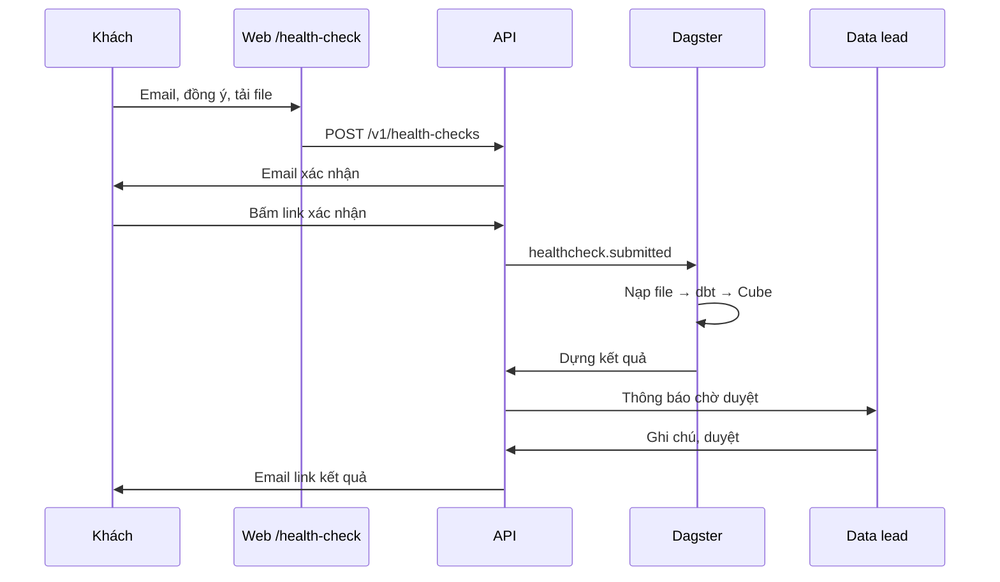

# Spec 07 – Kiểm tra sức khỏe dữ liệu

Hệ thống: S5. Yêu cầu: FR-HC-01..05, NFR-03, NFR-11.

Phạm vi: trang công khai nhận file, adapter đọc file, xử lý trong dataset tạm bằng chính pipeline và chỉ số của gói Seller, duyệt và gửi kết quả, xóa dữ liệu sau 14 ngày, chuyển thành khách.

Nguyên tắc: kiểm tra sức khỏe là một "khách tạm" với `tenant_id = hc_<check_id>`. Nó đi qua cùng dbt, cùng Cube, cùng bộ máy chỉ số như khách thật. Không có code tính chỉ số riêng (FR-HC-02).

---

## 1. Luồng



## 2. Trang công khai (FR-HC-01)

`/health-check`, không cần đăng nhập.

| Trường | Ràng buộc |
|---|---|
| Email | Bắt buộc, phải xác nhận qua link trước khi xử lý |
| Tên shop | Không bắt buộc |
| File | Tối đa 10 file, mỗi file tối đa 20 MB, `.xlsx` hoặc `.csv`. Mỗi file chọn loại từ danh sách mục 4.1 |
| File giá vốn | Không bắt buộc; dùng đúng mẫu Excel của spec 05 mục 6.4 |
| Đồng ý | Bắt buộc, nội dung ở mục 2.1 |

- Mỗi loại file có hướng dẫn ngắn "Xuất file này ở đâu" kèm ảnh chụp màn hình trong `apps/web/public/hc-guides/`.
- Phía client kiểm tra đuôi và kích thước; phía server kiểm tra lại và nhận diện loại file (mục 4.2).
- Sau khi gửi: trang báo "Kiểm tra email để xác nhận. Kết quả sẽ được gửi trong 1–2 ngày làm việc."

### 2.1 Nội dung đồng ý (NFR-11)

Ô đánh dấu, văn bản đặt trong `knowledge/legal/health-check-consent.md` và hiển thị nguyên văn:

- Mục đích: phân tích phí, lãi theo SKU, hoàn hàng và chênh lệch số liệu để gửi kết quả cho người gửi.
- Dữ liệu được xử lý trên máy chủ đặt tại Singapore (Google Cloud).
- Thông tin cá nhân người mua trong file bị loại bỏ ngay khi đọc file, không được lưu.
- Dữ liệu tự xóa sau 14 ngày kể từ khi tải lên, trừ khi người gửi đồng ý chuyển sang dịch vụ chính thức.
- Liên hệ để yêu cầu xóa sớm.

Phiên bản văn bản đồng ý được lưu cùng lượt kiểm tra.

## 3. Dữ liệu

| Bảng | Cột chính |
|---|---|
| `health_checks` | `check_id` (ULID chữ thường), `email`, `shop_name`, `status`, `consent_version`, `consent_at`, `email_token_hash`, `email_verified_at`, `access_token_hash`, `result` jsonb, `reviewer_notes_md`, `reviewed_by`, `approved_at`, `expires_at` (= tạo + 14 ngày), `deleted_at`, `converted_tenant_id`, `ip_hash` |
| `health_check_files` | `id`, `check_id`, `declared_kind`, `detected_kind`, `filename`, `size_bytes`, `gcs_path`, `status` (`received`, `loaded`, `rejected`), `error_code`, `error_message_vi` |

`status` của lượt kiểm tra: `uploaded` → `verified` → `processing` → `ready_for_review` → `approved`; hoặc `failed`, `expired`, `converted`.

File gốc lưu ở `gs://dx-hc-<env>/<check_id>/<file_id>` (ở `local`: `./.local/hc/`), bucket có lifecycle xóa sau 15 ngày làm lưới an toàn.

## 4. Đọc file

### 4.1 Loại file giai đoạn 1

| `kind` | Nguồn | Nội dung | Bảng raw tạo ra |
|---|---|---|---|
| `shopee_orders` | Shopee Seller Centre, xuất đơn hàng | Đơn và dòng đơn | `shopee_file__orders`, `shopee_file__order_lines` |
| `shopee_income` | Shopee, báo cáo doanh thu (đã quyết toán) | Phí và tiền thực nhận theo đơn | `shopee_file__fees` |
| `tiktok_shop_orders` | TikTok Shop Seller Center, xuất đơn | Đơn và dòng đơn | `tiktok_shop_file__orders`, `tiktok_shop_file__order_lines` |
| `tiktok_shop_settlement` | TikTok Shop, báo cáo quyết toán | Phí theo đơn | `tiktok_shop_file__fees` |
| `lazada_orders` | Lazada Seller Center, xuất đơn | Đơn và dòng đơn | `lazada_file__orders`, `lazada_file__order_lines` |
| `lazada_transactions` | Lazada, báo cáo giao dịch | Phí theo đơn | `lazada_file__fees` |
| `meta_ads` | Meta Ads Manager, xuất báo cáo theo ngày và chiến dịch | Chi tiêu, kết quả | `meta_ads_file__ad_insights_daily` |
| `tiktok_ads` | TikTok Ads Manager | Như trên | `tiktok_ads_file__ad_insights_daily` |
| `google_ads` | Google Ads, báo cáo chiến dịch theo ngày | Như trên | `google_ads_file__ad_insights_daily` |
| `product_costs` | Mẫu giá vốn của DataxLand | Giá vốn | `portal_file__product_costs` |

### 4.2 Adapter

`pipelines/connectors/files/`:

```
files/
  signatures.yml       # nhận diện loại file theo tên cột tiêu đề
  readers.py           # đọc xlsx (openpyxl, read_only) và csv (tự nhận mã hóa UTF-8/UTF-16, dấu phân cách)
  adapters/
    shopee_orders.py  shopee_income.py  ...
  source.py            # @dlt.source files_source(check_id, files)
```

- `signatures.yml`: mỗi `kind` có danh sách cột bắt buộc (cả tên tiếng Việt và tiếng Anh vì sàn đổi ngôn ngữ xuất theo cài đặt). Nhận diện bằng tỷ lệ cột khớp ≥ 80%.
- `detected_kind` khác `declared_kind` → từ chối file đó với thông báo "File này giống <loại nhận diện được>, không phải <loại đã chọn>". Không nhận diện được → "File không đúng mẫu <loại đã chọn>. Thiếu các cột: …" kèm link hướng dẫn.
- **Loại thông tin cá nhân khi đọc (NFR-03):** adapter chỉ giữ danh sách cột cho phép; tên người mua, số điện thoại, địa chỉ, email bị bỏ trước khi ghi raw. Mã người mua nếu có được băm ngay bằng muối tạm của lượt kiểm tra.
- Bảng raw tạo ra thỏa hợp đồng spec 01 mục 1, với `_dx_source_account = 'file'`.
- Mỗi adapter có model staging tương ứng trong `transform/models/staging/<source>_file/` thỏa hợp đồng đầu ra của spec 02 mục 3.2. Phần còn lại của dbt không đổi.

## 5. Xử lý (FR-HC-02)

Job Dagster `healthcheck` (kích hoạt bởi `healthcheck.submitted`):

1. Tạo dataset `hc_<check_id>_raw`, `_stg`, `_core`, `_marts` với nhãn `dx_kind=healthcheck`, `expires=<ngày>`; đặt `default_table_expiration` 15 ngày làm lưới an toàn.
2. Nạp file bằng `files_source`. File lỗi được đánh dấu `rejected`, các file khác vẫn chạy. Không còn file hợp lệ nào → `failed`, báo team.
3. `dbt build` với `dataset_prefix = hc_<check_id>`, `tenant_id = hc_<check_id>`, `pack = seller`, `sources` = các nguồn `*_file` đã nạp, `cost_allocation = by_revenue`. Bỏ test độ tươi và đối soát (`--exclude tag:freshness tag:reconcile`). Test khóa và ánh xạ vẫn chạy; lỗi ánh xạ không chặn mà được liệt kê trong kết quả cho data lead.
4. Làm mới Cube cho `securityContext {tenant_id: hc_<check_id>, dataset_prefix: hc_<check_id>}`.
5. Gọi `POST /v1/internal/health-checks/{id}/build`. API dùng bộ máy chỉ số với ngữ cảnh nội bộ của lượt kiểm tra để dựng `result` (mục 6), đặt `ready_for_review`, phát `healthcheck.completed`, báo team.

`ops/bootstrap_tenant.py` không chạy cho lượt kiểm tra; job tự tạo dataset với tài khoản dịch vụ `dx-healthcheck`, chỉ có quyền trên dataset tiền tố `hc_`.

## 6. Kết quả (FR-HC-03)

`result` là ảnh chụp số liệu giống báo cáo tuần (mọi số kèm `version`). Các phần:

| Phần | Chỉ số | Cách trình bày |
|---|---|---|
| Tổng quan | `gmv`, `net_revenue`, `order_count`, `net_profit_after_fees` (hoặc `contribution_margin` khi không có giá vốn) | Thẻ số cho cả kỳ trong file |
| Phí ăn vào lãi | `platform_fees`, `payment_fees`, `shipping_cost`, `return_cost`, `allocated_ad_spend` theo `platform`, kèm tỷ lệ trên `net_revenue` | "Phí sàn và thanh toán đã lấy X ₫, bằng Y% doanh thu" |
| SKU lỗ sau phí | `sku_profit` theo `product`, các SKU âm, sắp theo mức lỗ | Bảng; khi không có giá vốn, ghi rõ đây là lãi trước giá vốn |
| Hoàn hàng | `return_rate`, `return_cost` theo `platform` và theo `product` (top 10) | Bảng và nhận xét |
| Chênh lệch nguồn | Đơn `completed` trong file đơn nhưng không có trong file quyết toán (số đơn, giá trị); `platform_vs_actual_gap` nếu có file quảng cáo | Danh sách |
| Chất lượng file | File bị từ chối, trạng thái chưa ánh xạ, khoảng ngày của từng file | Chỉ hiện cho data lead |

### 6.1 Duyệt và gửi

- `/ops/health-checks`: danh sách theo trạng thái.
- `/ops/health-checks/[id]`: xem trước kết quả như khách sẽ thấy, ô ghi chú (Markdown, hiện đầu trang kết quả), nút "Duyệt và gửi".
- Duyệt → tạo `access_token`, gửi email cho người gửi với link `/health-check/<check_id>?k=<token>`. Trang này không cần đăng nhập, chỉ hiển thị từ `result`, có lời mời đặt lịch tư vấn và ngày dữ liệu sẽ bị xóa.

## 7. Xóa sau 14 ngày (FR-HC-04)

Job `healthcheck_cleanup` (03:00 hằng ngày):

- Với mỗi lượt có `expires_at < now()` và chưa `converted`, chưa `deleted_at`: xóa 4 dataset `hc_<check_id>_*`, xóa thư mục GCS, xóa cache Cube của `hc_<check_id>`, xóa `result` (giữ số đếm tổng hợp để thống kê phễu), đặt `status = expired`, `deleted_at = now()`.
- Ghi log mỗi lượt xóa (`check_id`, thời điểm, số bảng, số file) vào log và bảng `audit_log`.
- Lỗi xóa một lượt không dừng các lượt khác; báo team.
- Trang tải file, email xác nhận và trang kết quả đều ghi rõ ngày xóa.

## 8. Chuyển thành khách (FR-HC-05)

`POST /v1/ops/health-checks/{id}/convert {tenant_id, pack}` (data lead):

1. Sinh bản nháp `tenants/<tenant_id>.yml` từ các loại file (`*_file` → nguồn API tương ứng, `connector: dlt` hoặc `windsor`), điền mặc định của gói, trả về nội dung để data lead mở PR. Nếu có ánh xạ trạng thái được thêm khi xử lý, sinh kèm file ghi đè.
2. Chỉ khi người gửi đã đồng ý chuyển (ô đồng ý thứ hai trên trang kết quả, lưu `consent_convert_at`): sau khi khách mới được bootstrap, sao chép bảng raw `*_file__*` sang `t_<tenant_id>_raw` để có thêm lịch sử. Rồi xóa dữ liệu tạm như mục 7.
3. Đặt `status = converted`, `converted_tenant_id`.

## 9. Endpoint

| Method | Đường dẫn | Ai gọi | Mô tả |
|---|---|---|---|
| `POST` | `/v1/health-checks` | Công khai | `multipart/form-data`: `email`, `shop_name?`, `consent_version`, `files[]`, `kinds[]`. Trả `202 {check_id}` |
| `GET` | `/v1/health-checks/verify?token=` | Công khai | Xác nhận email, phát `healthcheck.submitted` |
| `GET` | `/v1/health-checks/{id}/result?k=` | Công khai | Kết quả đã duyệt |
| `POST` | `/v1/health-checks/{id}/consent-convert?k=` | Công khai | Đồng ý chuyển dữ liệu sang dịch vụ chính thức |
| `GET` | `/v1/ops/health-checks` | `healthchecks.review` | Danh sách |
| `GET` | `/v1/ops/health-checks/{id}` | `healthchecks.review` | Chi tiết, file, kết quả |
| `PUT` | `/v1/ops/health-checks/{id}` | `healthchecks.review` | Ghi chú |
| `POST` | `/v1/ops/health-checks/{id}/approve` | `healthchecks.review` | Duyệt và gửi |
| `POST` | `/v1/ops/health-checks/{id}/convert` | `healthchecks.review` | Mục 8 |
| `POST` | `/v1/internal/health-checks/{id}/build` | Dagster | Dựng kết quả |

Giới hạn tần suất theo spec 05 mục 8. Có honeypot field và kiểm tra thời gian điền biểu mẫu để chặn bot đơn giản.

## 10. Dữ liệu mẫu và kiểm thử

- `transform/samples/files/`: một file mẫu cho mỗi `kind` ở mục 4.1, sinh từ cùng dữ liệu của `demo_seller` bằng `ops/gen_samples.py`, có cột thông tin người mua giả để kiểm tra việc loại bỏ.

| Test | Nội dung | FR |
|---|---|---|
| `test_fr_hc_01_detect_wrong_file` | File Lazada chọn nhầm là Shopee bị từ chối với thông báo đúng | FR-HC-01 |
| `test_fr_hc_02_same_metrics_code` | Kết quả `net_revenue` của lượt kiểm tra từ file mẫu bằng `net_revenue` của `demo_seller` cùng kỳ (sai lệch do khác nguồn ≤ 1%) | FR-HC-02 |
| `test_fr_hc_02_no_metric_sql_outside_semantic` | Quét code `services/api` và `pipelines/connectors/files`: không có SQL tính chỉ số | FR-HC-02 |
| `test_fr_hc_03_result_sections` | `result` có đủ các phần ở mục 6 | FR-HC-03 |
| `test_fr_hc_03_requires_approval` | Chưa duyệt thì link kết quả trả 404 | FR-HC-03 |
| `test_fr_hc_04_cleanup_after_14_days` | Lượt quá hạn bị xóa dataset và file; lượt `converted` không bị xóa trước khi sao chép xong | FR-HC-04 |
| `test_nfr_03_file_pii_dropped` | Raw của lượt kiểm tra không có cột tên, điện thoại, địa chỉ người mua | NFR-03 |
| `test_fr_hc_05_convert_draft_config` | Bản nháp cấu hình qua được `dx_common.tenants.validate` | FR-HC-05 |

## 11. Tiêu chí hoàn thành

- Trên `dev`, tải bộ file mẫu, xác nhận email, nhận được bản chờ duyệt trong 30 phút, duyệt và mở được trang kết quả.
- Job xóa chạy hằng ngày, có log; trang tải file ghi rõ thời hạn 14 ngày.
- Mọi test ở mục 10 qua.
